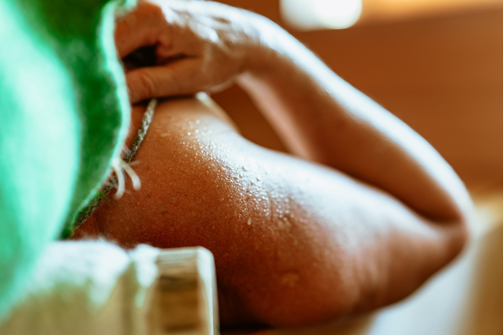

*Push hard, sweat harder. But recovery? That’s where the real gains come in. Step into the heat.*

When you train hard, your muscles, joints, nervous system—all of it gets taxed. Recovery isn’t optional; it’s where the growth, strength, and resilience happen. Sauna sessions are one of the most effective tools in your recovery toolbox. Let’s walk through *why* they work, *how* to use them, and *what the evidence says*, so you get the best gains with less soreness and more performance.

### **Why Heat Helps Recovery**

*Warmth around your skin, blood pulsing in your veins, the world softening as the sweat kicks in.* That’s more than comfort - it’s physiology in action.

- **Improved Blood Flow & Nutrient Delivery  
  **Heat causes blood vessels to dilate. More blood flows into muscles. Oxygen, nutrients, immune cells show up faster. This helps repair micro-damage from training ([Sports Illustrated](https://www.si.com/everyday-athlete/training/why-saunas-are-a-game-changer-for-heart-health-and-athletic-longevity?utm_source=chatgpt.com)).
- **Heat Shock Proteins (HSPs) & Cellular Repair  
  **The thermal stress from heat triggers production of HSPs—molecular helpers that protect cell structures, reduce oxidative stress, and assist in repairing damage ([Frontiers in Sports & Active Living, 2025](https://www.frontiersin.org/journals/sports-and-active-living/articles/10.3389/fspor.2025.1462901/full?utm_source=chatgpt.com)).
- **Reduced Inflammation & Faster Soreness Relief  
  **Post-workout, you get tiny tears, metabolic by-products, inflammation. Sauna can help reduce these markers, or help the body clear them faster. Evidence shows regular use of sauna helps reduce soreness and inflammation ([PMC review, 2023](https://pmc.ncbi.nlm.nih.gov/articles/PMC10286597/?utm_source=chatgpt.com)).
- **Neuromuscular Recovery & Power Gains  
  **Regular post-exercise sauna use has shown up in studies boosting power output (jumps, sprints) after weeks of training, compared with training without sauna recovery ([Frontiers in Sports & Active Living, 2025](https://www.frontiersin.org/journals/sports-and-active-living/articles/10.3389/fspor.2025.1462901/full?utm_source=chatgpt.com)).
- **Cardiovascular Benefits & Heat Tolerance  
  **Heat exposure can mimic effects of moderate aerobic work: raising heart rate, improving vascular function, increasing plasma volume. Over time, this improves endurance and heat tolerance ([Journal of Thermal Biology, 2023](https://www.tandfonline.com/doi/full/10.1080/23328940.2023.2300623?utm_source=chatgpt.com)).

### **What the Studies Say: Recent Evidence**

Some of the recent evidence surrounding sporting performance and saunas shows that you can feel the benefits of after just a single session when combined with resistance training.

- A 2025 study with female team-sport athletes added **infrared sauna sessions (10 min at ~50°C, three times per week, post-training)** to a 6-week strength program. Result: jump height and power improved more in the sauna group than control ([Frontiers in Sports & Active Living, 2025](https://www.frontiersin.org/journals/sports-and-active-living/articles/10.3389/fspor.2025.1462901/full?utm_source=chatgpt.com)).
- A *single* sauna session after resistance training improved neuromuscular performance and reduced soreness ([PMC, 2023](https://pmc.ncbi.nlm.nih.gov/articles/PMC10286597/?utm_source=chatgpt.com)).
- Broader reviews show regular sauna bathing plus exercise has additive benefits for endurance, recovery, and heat adaptation ([PMC, 2022](https://pmc.ncbi.nlm.nih.gov/articles/PMC9394774/?utm_source=chatgpt.com)).

### **How to Use Sauna for Recovery**

As a sauna for hire we realise that people can’t choose us every day. But our aim is to work with more and more sporting events in Portugal to give people an opportunity to use our hot and cold therapy options as post exercise recovery.

- **Timing:** Step in after your workout, ideally within 30–60 minutes, while your body is still warm.
- **Duration & Temperature:** For infrared, aim for 10–15 minutes at 50–60°C. In a traditional sauna, shorter bursts of 5–10 minutes at higher heat work best, with breaks in between ([Frontiers, 2025](https://www.frontiersin.org/journals/sports-and-active-living/articles/10.3389/fspor.2025.1462901/full?utm_source=chatgpt.com)).
- **Frequency:** Two to three sessions per week after training shows the strongest recovery benefits. Consistency matters more than going all-in once.
- **Contrast Therapy:** Alternate with cold exposure (ice bath or cold shower) to flush inflammation and give your body a sharper reset.
- **Hydration:** Replace sweat losses. Water first, electrolytes if you’ve gone long or heavy.
- **Listen to Your Body:** Heat should help you feel primed, not wiped out. Step out if you feel dizzy or drained.

### **Conclusion**

Used wisely, sauna is more than relaxation—it accelerates recovery, reduces soreness, improves cardiovascular function, and even boosts performance. You can hire our mobile sauna for events in Portugal giving athletes the chance to feel the benefits of this amazing tool for recovery. Step in after training, keep it consistent, and let the heat do the work.
