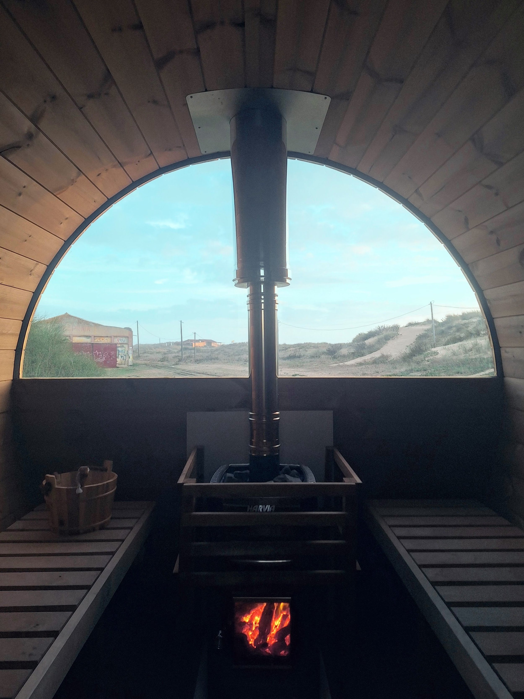

Elegir una estufa para una sauna puede ser una tarea abrumadora. Cuando construimos nuestra sauna móvil, pasamos horas estudiando las fichas técnicas de muchas estufas. Volumen de la sauna, superficie de cristal, tiempo de calentamiento, leña o eléctrica: a veces parece que hay más preguntas que respuestas.

Quería escribir algo detallado para ayudar tanto a nuestros clientes a la hora de comprar una sauna como a otros aficionados a la sauna a los que les pueda interesar. Como nota, usamos la Harvia M3 en nuestra sauna móvil; la tenemos desde hace varios meses y ha recorrido el país de arriba abajo para [festivales y eventos privados](/es/para-eventos). Este análisis se basa en esa experiencia y será útil para cualquiera que esté pensando en comprar una sauna en Portugal.

## Por qué elegimos la Harvia M3 para una sauna de leña

Nos planteamos una estufa de leña en lugar de una eléctrica porque queríamos la máxima flexibilidad para colocar la sauna donde quisiéramos. En una sauna móvil, la pista está en el nombre: tiene que poder moverse. Elegir leña nos permite ser totalmente independientes de la red eléctrica cuando salimos a la carretera.

Elegir una Harvia fue entonces una decisión obvia. Queríamos algo de una marca finlandesa que formara parte de la experiencia que ofrecíamos. Había viajado a Finlandia en varias misiones de exploración de saunas, y Harvia es el nombre que aparece en todas las saunas de allí. Desde pequeñas saunas de cabaña para 2 personas hasta saunas dentro de la habitación del hotel.

Un factor enorme para nosotros era la sencillez y la fiabilidad: como negocio de alquiler privado, tenemos que poder enseñar a la gente a usar la estufa con seguridad y asegurarnos de que no les intimide. La Harvia M3 cumple esos requisitos a la perfección: si sabes encender una pequeña hoguera, sabes encender la sauna.

## Resumen técnico de la Harvia M3 (lo que de verdad importa)

Una de nuestras dudas con una estufa «más pequeña» era si podría calentar rápido desde frío y qué potencia total tendría. En la práctica, no ha sido ningún problema. Con 16 kW de potencia, la Harvia M3 va sobrada tanto con el fuego a pleno rendimiento como cuando la leña ya está en brasas. De hecho, esta potencia supera con creces la que la mayoría de la gente conseguirá nunca con una estufa eléctrica, salvo que haga grandes mejoras en su instalación eléctrica.

El factor clave para calcular la potencia que necesita tu sauna es el volumen interior, es decir, el tamaño del espacio que quieres calentar. Nuestra sauna barril móvil tiene un volumen interior de unos 7,3 m3, y con la Harvia M3 conseguimos que el calor llegue a toda la sauna. No hay zonas frías a la altura de los pies y la diferencia de temperatura entre la parte delantera y la trasera apenas se nota.

## La instalación en Portugal

En cuanto a la instalación, la Harvia M3 no presentó grandes dificultades. Es una estufa grande y pesada, así que colocarla en su sitio puede costar; las piedras vienen embaladas aparte, lo cual es un alivio porque la estufa resulta menos aparatosa.

Pudimos pasar la chimenea por el techo usando un tubo aislado especial para atravesar la madera. Sorprende lo bien que aísla el sistema de chimenea: incluso en uso, la chimenea rara vez quema al tocarla.

Un punto a vigilar en la construcción son las distancias de seguridad de la chimenea. Conviene que sobresalga bastante del techo para no echar el humo directamente sobre la cubierta. Pero si es demasiado alta queda un poco ridícula: hay que encontrar el equilibrio.

## Tiempo de calentamiento y gestión del fuego

El tiempo de calentamiento y la gestión del fuego son las dos preguntas que más nos hacen quienes compran y alquilan saunas.

Portugal disfruta de un clima bastante templado, aunque por la alta humedad muchas veces se siente más frío de lo que marca el termómetro. Pocas veces hemos tenido que calentar la sauna partiendo de menos de 10 grados, lo que supone una gran diferencia respecto a otras partes de Europa en invierno.

Nuestra experiencia es que la sauna con la Harvia M3 tarda unos 35 minutos en llegar a una temperatura utilizable de 75 grados. A partir de ahí, es cuestión de gustos hasta dónde quieras subir. Lo que notamos es que el calor sube muy despacio al principio y luego hay un punto de inflexión claro en el que las piedras empiezan a generar mucho calor y la temperatura se dispara.

**Algunos tiempos de calentamiento aproximados según nuestra experiencia:**

- 75 °C - 35 minutos
- 85 °C - 45 minutos
- 95 °C - 60 minutos

Mantener el calor a una temperatura constante es algo que siempre intentamos afinar; es una de las ventajas y de los misterios de una estufa de leña. Requiere mano izquierda y tiempo para entender de verdad cómo mantener la temperatura y ajustarla poco a poco, en lugar de oscilar entre 70° y 90° sin mucho control.

## Calidad del vapor y sensación en la sauna (la prueba del löyly)

Una de las mejores cosas que hemos notado tras meses de uso es la calidad del calor y del vapor que genera la M3. Es difícil de cuantificar: esa sensación exacta que hace que disfrutes del calor en vez de encontrarlo incómodo. No todos los calores son iguales; el de nuestra sauna remolque tiene una suavidad que la hace muy agradable. Como comparación, pienso en la sauna de mi gimnasio, que no ofrece ni de lejos la misma sensación.

Un factor que se nota en lo agradable que resulta el calor es el número de personas en la sauna. Con un par de personas más, el aire mantiene algo más de humedad, resultado natural de los cuerpos y la respiración. Cuando estás solo, el aire se seca muy rápido y, con menos circulación de aire (menos movimiento y menos aperturas de puerta), también puede calentarse muchísimo en poco tiempo.

## Calidad de construcción, materiales y durabilidad

Al tratarse sobre todo de una unidad de alquiler, la calidad de construcción y la durabilidad pesaron muchísimo al comprar la estufa. Siempre limpiamos las partes de acero y cristal con un simple paño húmedo después de usarla. En general, la estufa ha aguantado bien el uso regular durante varias horas seguidas y los traslados por todo el país en un remolque. Obviamente, estas estufas no están pensadas para moverse mucho una vez instaladas, así que estamos poniendo la nuestra a prueba de verdad.

El hogar y la zona de las piedras se sienten sólidos, igual que la puerta de cristal, que se abre y cierra muchísimas veces.

Hemos notado algunas pequeñas manchas de decoloración, sobre todo alrededor del tubo de salida a la chimenea. Esperamos evitar cualquier óxido en la estufa, pero cuando hablamos de agua, calor y tiempo, el riesgo siempre está ahí.

Lo único que parece un poco endeble es el cajón de cenizas. No es grave, porque no hace falta vaciar la ceniza muy a menudo, pero comparado con el resto del producto parece algo frágil y no siempre encaja bien.

## Tipos de leña y coste de uso

Una gran preocupación cuando nos decidimos por la estufa de leña era la calidad y el suministro de leña que podríamos conseguir en Portugal.

Una breve introducción a la leña: la madera dura arde más despacio, más caliente y de forma más constante que la madera blanda. Esto se debe a que las maderas más densas tienen un mayor poder calorífico.

Las maderas blandas son estupendas para encender el fuego porque prenden rápido y dan llama enseguida. Pero también se consumen igual de rápido. En una sauna, ese calor dura poco, es irregular y obliga a reponer leña constantemente.

Si quieres una temperatura estable, combustiones largas y reponer menos, la madera dura es imprescindible. Es la que da ese calor profundo y asentado que se mantiene mientras te relajas.

Estos son algunos tipos de leña fáciles de encontrar en Portugal.

**Maderas duras - ideales para sesiones largas**

- Carvalho - roble portugués
- Azinheira - encina
- Sobreiro - alcornoque
- Oliveira - olivo

**Maderas blandas - buenas para encender, pero no para el resto de la sesión**

- Pinho - pino
- Cedro - cedro

El eucalipto, aunque es muy común en Portugal, conviene evitarlo en general por su alto contenido en aceites, que puede dañar la estufa.

Según nuestra experiencia, la sauna resulta muy económica con leña dura de buena calidad y bien seca. Una vez encendido el fuego, necesita aproximadamente 1 tronco cada 20 minutos para mantener la temperatura.

## Pros y contras de la Harvia M3

### **Pros**

- Calor de gran calidad para una estufa relativamente pequeña
- Eficiencia excelente en el consumo de leña
- Sensación de calor ideal: suave a temperaturas bajas y no demasiado intensa a temperaturas altas

### **Contras**

- Muestra enseguida marcas de uso, incluso con un buen cuidado
- El cajón de cenizas parece endeble

## Para quién es ideal la Harvia M3

**Saunas exteriores domésticas**  
La Harvia M3 brilla especialmente en exteriores. Saunas de jardín, cabañas y construcciones independientes donde la ventilación y el paso de la chimenea son sencillos. Da un calor estable sin depender de la instalación eléctrica de la casa y, una vez alcanzada la temperatura, la mantiene de maravilla.

**Instalaciones sin conexión a la red**  
Si tienes una sauna en un lugar remoto, o en cualquier sitio donde la electricidad es limitada o cara, como en gran parte de Portugal, la M3 tiene todo el sentido. Sin grandes obras eléctricas ni cálculos de carga: solo hay que añadir leña.

**Quienes disfrutan cuidando del fuego**  
Esta estufa no es de «encender y olvidarse». La enciendes, la alimentas, aprendes cómo se comporta y acabas hablando con la gente del poder calorífico del roble frente al del olivo. Para la persona adecuada, de eso se trata. El crepitar del fuego, el olor de la piedra caliente. Una experiencia táctil y práctica que las estufas eléctricas simplemente no pueden reproducir.
