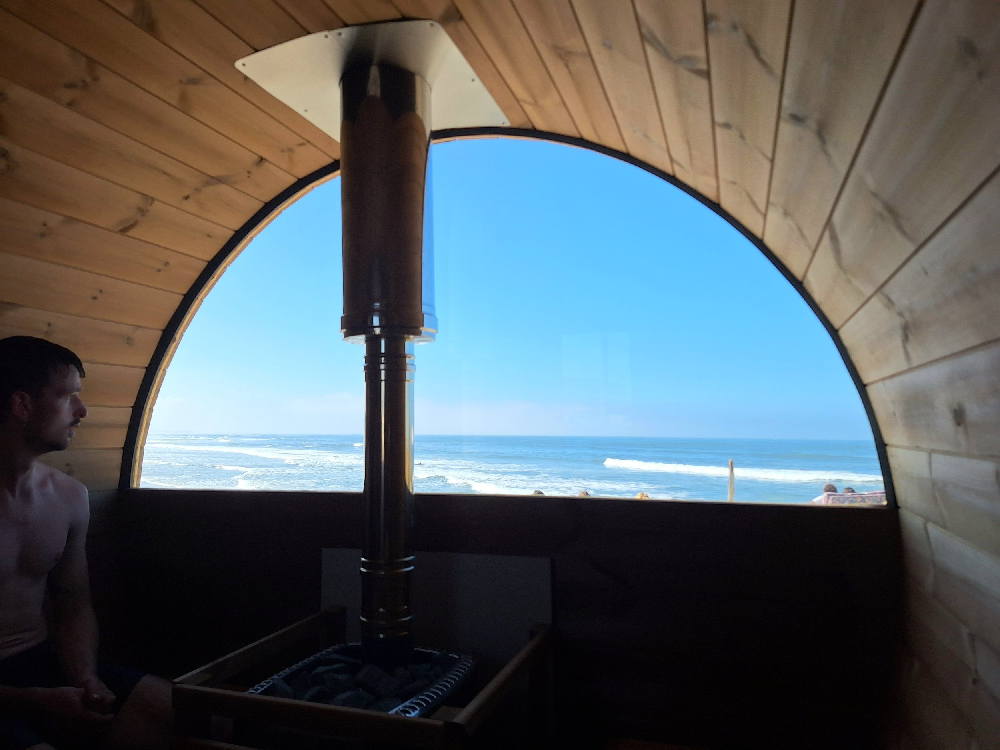
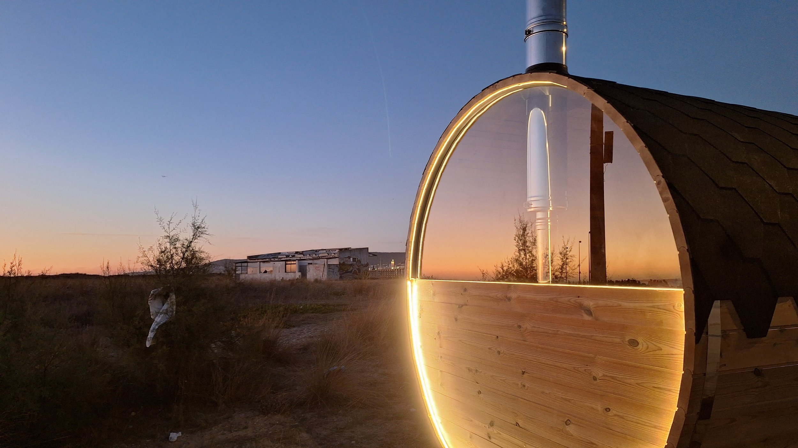
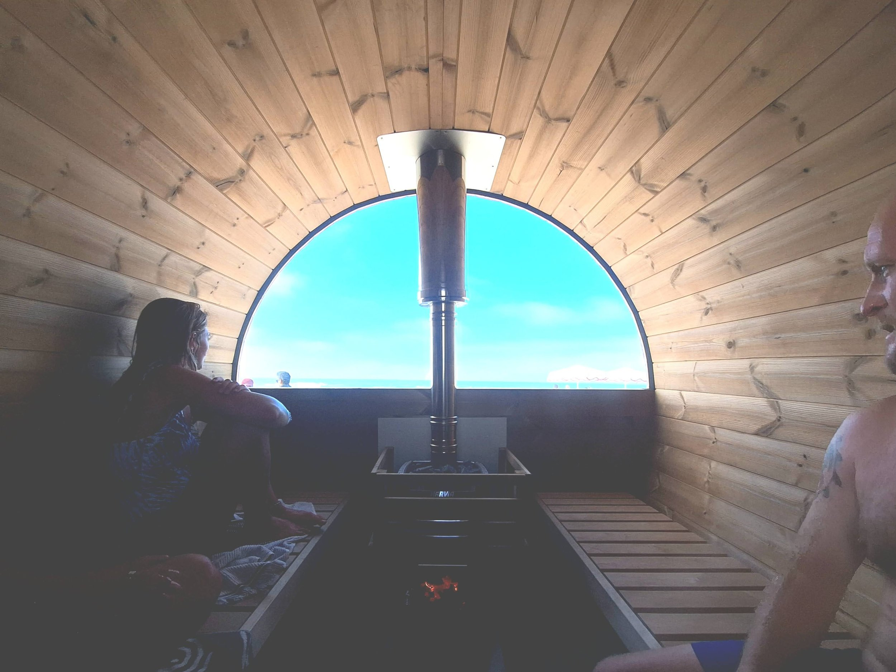
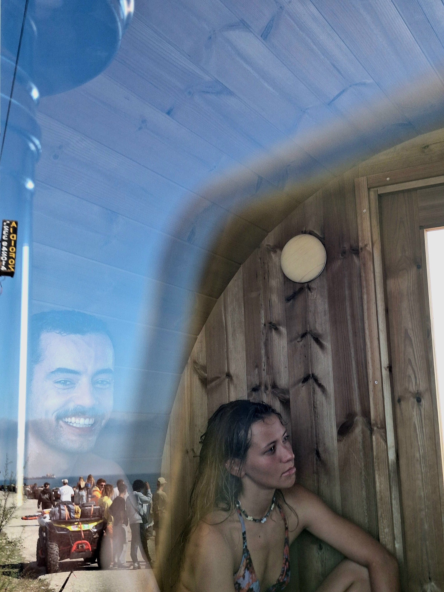
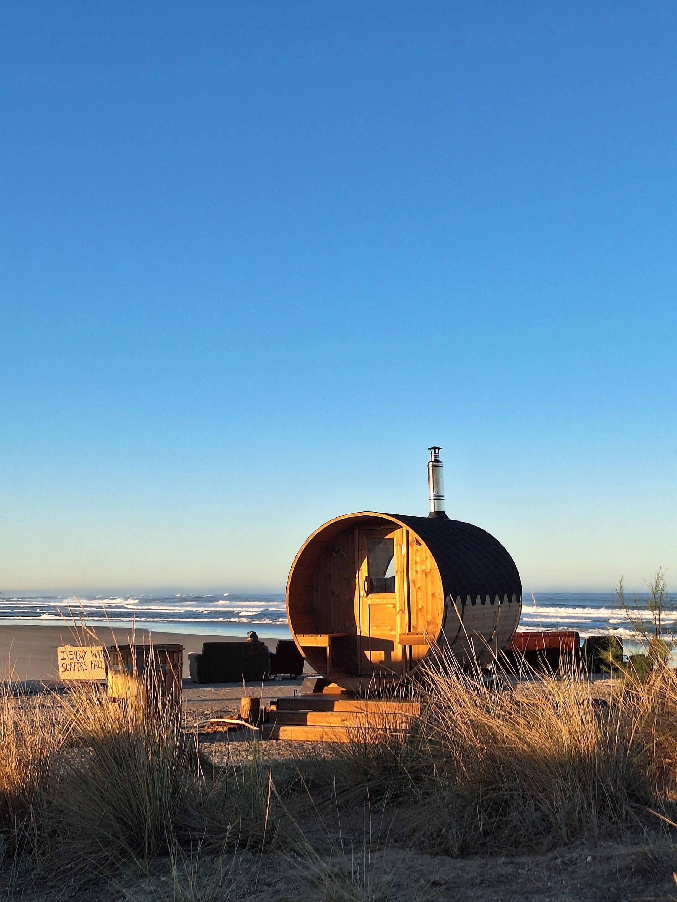

*Una vista increíble del pico de Praia do Cabedelo desde la ventana de la sauna.*

Hace unas semanas, el equipo de Sunna —más dos perros— fue a su primer festival: Gliding Barnacles, en Figueira da Foz. Gliding es un festival genial en el que ya había estado antes. Es una mezcla de surf con longboard, música ecléctica, arte vibrante y travesuras en general. Este año tuvimos el orgullo de aportar un poco de fuego y hielo.

El camino hacia Gliding empezó en agosto, cuando conocimos a Beatriz y Eurico y empezamos a hablar de cómo llevar la sauna. Ya entonces sabíamos que íbamos justos de plazos y de logística, con varias entregas previstas para principios de septiembre. Pero queríamos que saliera adelante, como forma de mostrar la sauna, disfrutar del festival y, con suerte, conocer a muchos amantes de la sauna en Portugal.

El viaje *de verdad* a Gliding Barnacles empezó unos días antes del festival, con un día entero de carretera desde el almacén donde la construimos hasta Figueira da Foz. Hasta ese momento, la sauna y el remolque solo habían dado unas vueltas por el aparcamiento, así que estábamos bastante nerviosos ante 400 km por autopista y carreteras nacionales de Portugal. Después de quedarnos atascados en un peaje, que nos parara un control policial, un paso de frontera de locos (no preguntéis) y *muchos* cafés y episodios de *The Rest Is History*, la sauna y nosotros llegamos al festival de una pieza.

Montar la sauna por primera vez en un evento nos dio mucho en qué pensar. Queríamos aprovechar al máximo un entorno increíble, con vistas directas desde la sauna al pico donde se surfeaba, pero también dar a la gente un espacio para relajarse entre sesiones, cambiarse, guardar sus cosas y pasar el rato. Nuestro rincón quedó justo en medio de todo, y queríamos que fuera abierto y acogedor para cualquiera con curiosidad por pararse y unirse.

Casi todo el festival se nos pasó volando: días largos, noches hasta tarde, limpieza sin fin y logística por resolver, pero aun así pudimos ver mucho surf. Gliding Barnacles tiene un formato único: no hay competición. Invitan a longboarders con mucho talento de todo el mundo y el evento se convierte en un escaparate de surf increíble. Muchos surfistas locales de Portugal y de Figueira conocen bien la ola, pero también había gente de Australia, Brasil y Marruecos que la surfeaba por primera vez. Verlos encontrar su ritmo y dominar las condiciones fue una auténtica alegría.

Adrien y yo llevamos nuestras tablas al festival. ¿Llegamos a usarlas? No. Ni una vez. Llámalo compromiso con el trabajo o mala planificación.

Al cabo de unos días, fue un placer empezar a ver caras conocidas, gente que venía a la sauna todos los días. Algunos se pasaban después de surfear, otros a primera hora de la mañana, y unos cuantos llegaban cerveza en mano, listos para la fiesta. Un saludo enorme a todos los que volvieron día tras día. Hicisteis que toda la experiencia fuera más divertida para nosotros. Trabajar en festivales puede resultar extrañamente solitario. Estás rodeado de gente, pero no siempre tienes ocasión de hablar y recibir opiniones, y es fácil perder la perspectiva. Tener un grupo de unas 30 personas a las que veíamos, con las que charlábamos y a las que fuimos conociendo un poco en unos días hizo que todo fuera muy especial.

Tenemos muchas ganas de llevar la sauna a más festivales y eventos de varios días por Portugal este invierno. Si organizas eventos o trabajas en ese ámbito, escríbenos.

A nuestros amigos de Gliding Barnacles: esperamos veros el año que viene.

Harry
