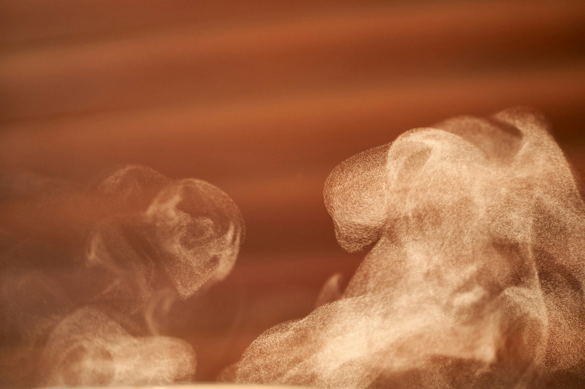

Empezar con la sauna consiste, sobre todo, en no complicarse. Ven, respira y deja que el calor haga lo suyo.

Aquí tienes nuestra guía para principiantes, para sudar como un profesional en nada de tiempo.

#### Cómo prepararte para tu primera sesión

Lo más importante es mantenerte hidratado. Puedes perder hasta 1,5 litros de agua en una sesión de sauna de una hora, así que tienes que reponerlos bebiendo mucha agua. Bebe agua antes y después de la sesión para mantener el cuerpo hidratado. Las bebidas con electrolitos, o cualquier cosa que tenga sal y azúcar, ayudan a reponer los minerales que se pierden con el sudor.

Evita las comidas copiosas justo antes de la sauna: quieres que tu cuerpo se centre en depurar, no en hacer la digestión. Que la sangre fluya hacia las extremidades y no hacia el sistema digestivo también te ayudará a mantenerte fresco.

Trae bañador, a menos que pienses hacerlo al estilo finlandés. Los bancos de madera de la sauna pueden calentarse mucho, así que una toalla te ayudará a proteger las piernas y la espalda.

#### Qué esperar en tu primera sesión de sauna

Es importante acostumbrar el cuerpo y la mente al calor. Las primeras respiraciones en una sauna pueden ser muy intensas; acostumbrarse a esa sensación de calor es el primer paso para relajarse y aceptar el calor. Tomarte unos minutos al principio para sentirte cómodo ayuda mucho.

Puede que quieras quedarte mucho tiempo o que tengas ganas de salir enseguida. La sauna no es una competición y cada persona es distinta, así que relájate y disfruta mientras te sientas bien.

Salir de la sauna es como tomar una bocanada de aire fresco; tómate tu tiempo para disfrutar del contraste. Ya fuera, deberías notar el aire sobre la piel. Es el efecto del sudor evaporándose y llevándose el calor del cuerpo.

Es un momento perfecto para darte una ducha fría, meterte en el mar o en cualquier agua fresca. ¡Un baño helado es todavía mejor! Cuando pase el impacto inicial del agua fría, empezarás a disfrutar del equilibrio entre el calor y el frío.

#### Consejos para una gran experiencia de sauna

Concéntrate en la respiración. Aunque cueste respirar hondo por el aire caliente, es importante regular la respiración. Así el cuerpo se adapta al calor.

Intenta estar presente y vivir el momento. Las saunas son para relajarse y compartir experiencias, no para pensar en el móvil o en las notificaciones. No va a pasar nada en la hora que estés sin móvil, así que guárdalo y olvídate de él.

La sauna consiste en soltar y encontrar tu propio ritmo. Tómatelo con calma y conviértela en parte habitual de tu rutina.
